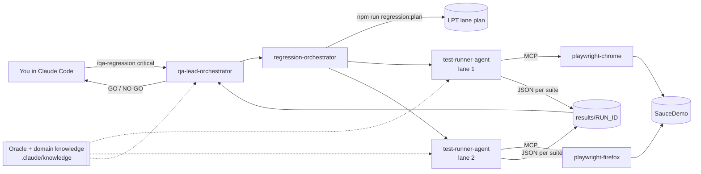

# agentic-qa-lean: reference implementation

**The open reference implementation of an agentic QA system.** Test cases are written in plain English
in CSV files. Claude Code agents run them in real browsers through
[Playwright MCP](https://github.com/microsoft/playwright-mcp), judge what they see against a
business-logic oracle, and return evidence-backed verdicts. Cases that become stable are promoted to
ordinary Playwright specs.

The demo target is [SauceDemo](https://www.saucedemo.com), a public practice shop. It has
**deliberate bugs built into some demo accounts**, so the agents find real defects on the first run.

> **This repository is a reference implementation, not a product.**
> It is a minimal, working illustration of the Agentic QA approach, published for learning and
> evaluation. It is intentionally limited (4 agents, 5 commands, 3 skills, 1 hook, no tracker integration, no
> secrets management) and is not intended for production use as is.
>
> **Agentic QA Enterprise**, the full implementation, is a **separate, proprietary offering**. It is
> **not open source**, **not contained in this repository**, and **not covered by this repository's
> MIT license**. It is available only through a commercial engagement (licensing, implementation and
> support). [Contact me on LinkedIn](https://www.linkedin.com/in/olga-manuylova/).

## Editions

| | **agentic-qa-lean** (this repository) | **Agentic QA Enterprise** |
|---|---|---|
| Purpose | Reference implementation: learn and evaluate the approach | Production implementation for teams and organisations |
| Availability | Public, open source (MIT) | Proprietary, commercial licence, private |
| Agents / commands / skills | 4 / 5 / 3 (light versions) | 10-agent crew + plugin agents / full command set / full methodology library |
| Prompt quality loop (review, heal, evidence-based improve) | Review only | ✓ |
| Plugin marketplace (setup, secrets, bug lifecycle, per-ticket testing) | — | ✓ |
| Autonomous bug-fix merge requests with independent review | — | ✓ |
| Practice app with seeded bugs and a full find → fix → independent review → verify cycle | — (a real bug found on SauceDemo, see below) | ✓ |
| GitLab / Jira integration, guardrails for trackers | — | ✓ |
| Credentials kept out of files (OS keychain, CI secrets) | — | ✓ |
| Scheduled and upstream-triggered agentic regression in CI | — | ✓ |
| Implementation support | None | Included in the engagement |

Everything in this repository is free to use under the MIT license. Nothing in this repository
grants any right to the Enterprise edition.

---

## Table of contents

1. [Why agentic QA](#why-agentic-qa)
2. [How it works](#how-it-works)
3. [Quick start](#quick-start)
4. [Daily use](#daily-use)
5. [Repository layout](#repository-layout)
6. [Configuration](#configuration)
7. [Writing test cases](#writing-test-cases)
8. [Agents and commands](#agents-and-commands)
9. [Skills: methods and quality](#skills-methods-and-quality)
10. [A real run, recorded](#a-real-run-recorded)
11. [Guardrails](#guardrails)
12. [CI on GitLab](#ci-on-gitlab)
13. [Adapting the template to your product](#adapting-the-template-to-your-product)
14. [Troubleshooting](#troubleshooting)
15. [Further reading](#further-reading)

---

## Why agentic QA

| Classic UI automation | Agentic QA (this template) |
|---|---|
| Scripts break when a locator or a flow changes | The agent reads the page like a user; small UI changes do not break a case |
| Checks only what was coded into `expect()` | Judges every observation against business rules: **always-on bug detection** |
| Writing a case takes code | A case is a row in a CSV a tester or analyst can write |
| Fast, cheap, deterministic | Slower and costs tokens, but explores and explains |

The two complement each other. Here the agents explore and judge, and the cheap deterministic specs
guard what is already stable (see [Promotion](docs/architecture.md#5-promotion-from-csv-case-to-playwright-spec)).

## How it works



1. **Cases** live in `regression/suites/**.csv`. The manifest `config/test-suites.json` registers every suite, the agent that owns it, and named **selections** such as `smoke`, `critical` and `full`.
2. **The planner** spreads a selection over browser **lanes**, longest suite first. Each lane is its own Playwright MCP server with an isolated browser.
3. **A runner agent per lane** executes the cases step by step, like a user. It checks assertions, console, network and storage, and watches for any violation of the **oracle** (`.claude/knowledge/oracles/business-logic.md`).
4. **Results** are one JSON per suite, with a verdict and evidence for every case. The **QA lead** merges them, classifies the findings and signs off with GO, GO-WITH-RISKS or NO-GO.

Read [docs/architecture.md](docs/architecture.md) for the details and the reasons behind each choice.

## Quick start

**Prerequisites:** Node.js 22+, Git, and [Claude Code](https://docs.claude.com/en/docs/claude-code/overview) (CLI, desktop app or IDE extension).

```bash
git clone <your-gitlab-url>/agentic-qa-lean.git
cd agentic-qa-lean
npm install
npx playwright install chromium firefox   # browsers for the MCP lanes and the specs

npm run check          # env:check + suites:lint + prompts:lint + unit tests — everything should be green
npm run suites:list    # what is there
```

Open the folder in Claude Code. On first start it asks to enable the project MCP servers from
`.mcp.json` (`playwright-chrome`, `playwright-firefox`, `playwright-mobile`). Approve them, and check
with `/mcp` that all three are connected.

Your first run:

```
/qa-smoke
```

A Chromium window opens, the runner signs in, buys a backpack and logs out. A few minutes later you
get a verdict. Then try the bug hunt:

```
/qa-regression bug-hunt
```

The `bug-hunt` suite runs as SauceDemo's `problem_user`, `error_user` and `visual_user`. **Its cases
are expected to fail.** Watch how the agents describe each defect, cite the broken rule and attach
screenshots.

## Daily use

| You want to… | Run |
|---|---|
| Know quickly whether the build is alive | `/qa-smoke` |
| Run a few suites | `/qa-run 003 004` (`--browser playwright-firefox`) |
| Run a whole selection in parallel with a sign-off | `/qa-regression critical` · `regression` · `full` |
| Explore an area without cases | `/qa-exploratory "checkout totals with 6 items"` |
| Turn an observation into a bug report | `/qa-bug "tax is off by a cent for 3 items"` |
| Design cases for a rule or feature | `/qa-test-design BL-CHK-001` |
| Check whether cases can catch bugs | `/qa-review-tests 004` (first pass: `npm run review:tests`) |
| Review an agent, command or skill you changed | `/prompt-review changed` (facts: `npm run prompt:facts -- all`) |
| Run the deterministic specs | `npm run specs:run` |
| See the lane plan without running | `npm run regression:plan -- full` |

Everything a run produces goes to `results/<RUN_ID>/`, which is gitignored: per-suite JSON,
`REPORT.md`, `SUMMARY.md` and screenshots.

## Repository layout

```
.
├── CLAUDE.md                     # always-loaded project brief for Claude Code
├── .mcp.json                     # browser lanes = Playwright MCP servers (no secrets)
├── .claude/
│   ├── agents/                   # qa-lead-orchestrator, regression-orchestrator,
│   │                             # test-runner-agent, qa-frontend-expert
│   ├── commands/                 # /qa-smoke /qa-run /qa-regression /qa-exploratory /qa-bug
│   ├── skills/                   # qa-test-design · qa-review-tests · prompt-review
│   ├── rules/testing.md          # always-on rules (kept short: paid on every turn)
│   ├── knowledge/                # loaded on demand
│   │   ├── shared-instructions.md   # verdicts, evidence, output contract
│   │   ├── cases-that-catch-bugs.md # what makes a test case worth keeping
│   │   ├── authoring-standard.md    # how to write agents, commands and skills
│   │   ├── oracles/business-logic.md
│   │   └── domain/saucedemo.md
│   ├── hooks/enforce-real-user.mjs
│   └── settings.json             # hook wiring + permissions
├── config/
│   ├── test-suites.json          # suite manifest + selections + browser pool
│   └── mcp-playwright-*.config.json   # one per lane: chrome, firefox, mobile
├── regression/suites/<domain>/NNN-name.csv
├── tests/*.spec.js               # promoted deterministic specs
├── test-data/aliases.<env>.json
├── scripts/                      # env loader, linters, planner, review helpers (+ unit tests)
├── examples/run-2026-11-23/      # a real recorded run: results, report, bug report
├── docs/                         # architecture, csv format, playbook
├── .env.defaults  .env.saucedemo # layered config (tracked, no secrets)
└── .gitlab-ci.yml
```

## Configuration

Configuration is layered. Later layers override earlier ones, and real environment variables override
all files:

| Layer | Tracked | Holds |
|---|---|---|
| `.env.defaults` | yes | Constants shared by all envs |
| `.env.<TEST_ENV>` | yes | URLs and account *names* for one environment |
| `.env.local` | **no** | Your machine-local overrides and, in a real project, passwords |

- Choose the environment with `TEST_ENV=<name>` or a one-line `.env.test-env` file (gitignored). The default is `saucedemo`.
- `npm run env:check` shows which layers loaded and which variables are set. It masks anything that looks like a secret.
- Add an environment by copying `.env.saucedemo` to `.env.staging`, changing the values and running `TEST_ENV=staging npm run env:check`.

The SauceDemo password is printed on SauceDemo's own login page, so it is safe to commit. **For
your own product, put passwords only in `.env.local`.** The Enterprise edition moves them into the OS
credential store.

## Writing test cases

A case is one CSV row with 15 columns. The important ones:

| Column | Example |
|---|---|
| `ID` | `CHK-004` |
| `Priority` | `Critical` / `High` / `Medium` / `Low` |
| `Business_Rule` | `BL-CHK-002` (must exist in the oracle) |
| `Preconditions` | `Signed in as {{STANDARD_USER}}; empty cart` |
| `Steps` | `[NAV] Navigate to {{FRONT_URL}}/` ⏎ `[ACT] Click 'Login'` ⏎ `[WAIT] …` |
| `Assertions` | `[TEXT] Tax: $4.32` ⏎ `[STATE] total = item total + round(item total × 0.08, 2)` |
| `Cross_Layer_Checks` | `[CONSOLE] No uncaught errors` ⏎ `[NETWORK] No 4xx/5xx` |
| `Failure_Signals` | `Rounding error; tax not 8%` |
| `Automation_Status` | `Agent` / `Candidate` / `Automated` / `Manual` |

Full specification, tag vocabulary and style guide: [docs/csv-format.md](docs/csv-format.md).
After editing, run `npm run suites:lint`. It checks the header, tags, placeholders, BL references,
unique ids, `testCount`, and that every CSV is registered in the manifest.

## Agents and commands

| Agent | Role | Drives a browser? |
|---|---|---|
| `qa-lead-orchestrator` | Plans, delegates, classifies, gives GO / NO-GO | No |
| `regression-orchestrator` | Turns a selection into parallel lanes and merges results | No |
| `test-runner-agent` | Executes CSV suites on one assigned lane | Yes, one lane |
| `qa-frontend-expert` | Focused, exploratory, reproduce and re-test work | Yes, one lane |

Each agent prompt is written in **four layers**: business logic, domain knowledge, skill set and
design decisions. Rules that every agent shares live once in `.claude/knowledge/shared-instructions.md`
and are cited, never copied. See [docs/architecture.md](docs/architecture.md#agent-prompts-four-layers).

## Skills: methods and quality

Agents know **who** does the work. Skills teach **how** to do it well. Commands orchestrate, agents act,
skills teach, knowledge informs (`.claude/knowledge/authoring-standard.md`).

| Skill | What it teaches | Deterministic helper |
|---|---|---|
| `qa-test-design` | Equivalence partitioning, boundary values, decision tables and state transitions, turned into ready-to-lint CSV rows. Includes a worked example on the checkout form that finds a case the suite was missing | `npm run suites:lint` |
| `qa-review-tests` | Can this case catch a bug? Five dimensions: determinism, testability, bug-catching intent, grounding, duplication | `npm run review:tests` |
| `prompt-review` | Reviews the system's own prompts (agents, commands, skills) for interface, executability, single source of truth, context economy and instruction craft | `npm run prompt:facts` |

Each skill collects **facts with a script first**, then applies judgement, and every finding needs
evidence. The principles behind them: [cases-that-catch-bugs.md](.claude/knowledge/cases-that-catch-bugs.md).

**Prompts are code an LLM executes, and they rot like code.** A cited path moves, a script gets
renamed, a copied rule drifts. `prompt-review` is how this system keeps its own instructions healthy.
Run it before committing any change under `.claude/`.

Both review skills were run on this repository while it was built. `review:tests` found a real
determinism problem in case CART-006 ("Add **any** two products": two agents would pick different
products), which is now fixed. Candidates a reviewer decided to keep are recorded with the reason in
`config/review-accepted.json`, so the next review does not argue the same point again.

`npm run prompts:lint` is the hard gate under `prompt-review`: a prompt whose frontmatter does not
parse loads with no description, so it is silently never picked.

## A real run, recorded

[`examples/run-2026-11-23/`](examples/run-2026-11-23/) is a live run of this repository against
SauceDemo in a real browser:

- **Smoke 5/5 PASS**, with exact evidence (checkout totals $29.99 + $2.40 = $32.39).
- **Bug found:** QRK-001, every product showing the same placeholder image for `problem_user`, caught by a business rule, not a pixel diff. See the bug report.
- **Two findings no step asked for:** deep links served with HTTP 404, and a new "Generate PDF order" button missing from the domain knowledge. Both are graded AMBIGUOUS for a human.

Read it before your first run, so you know what good output looks like.

This run shows the **find** half. Finding a bug in a product you don't own stops at a good bug report.
The Enterprise edition adds a practice app of its own with seeded bugs, so the whole cycle runs end
to end: the failing test first, the fix, a review by an agent that never saw the fixer's reasoning,
and the verification run, with the merge left to a human.

## Guardrails

- **Real-user hook.** `.claude/hooks/enforce-real-user.mjs` blocks JavaScript evaluation through any browser MCP tool, except read-only measurement. An agent cannot "pass" a case by clicking a disabled button through JS.
- **Lane isolation.** Each lane is a separate MCP server with `isolated: true`, so no cookies or cart are shared between agents.
- **Evidence or it did not happen.** A FAIL needs a screenshot and expected vs actual. Otherwise it is reported as AMBIGUOUS.
- **Gates.** `suites:lint` keeps the data honest and `npm test` covers the code. No code means no unit test.

## CI on GitLab

`.gitlab-ci.yml` has three stages:

| Job | When | Needs secrets |
|---|---|---|
| `env-and-suites`, `unit` | every MR and default branch | no |
| `playwright-specs` | every MR and default branch | no |
| `agentic-smoke` | manual, on scheduled or web pipelines | `ANTHROPIC_API_KEY` as a **masked** CI/CD variable |

The agentic job runs `claude -p "/qa-smoke"` headless, with an explicit tool allowlist, and stores
`results/` as an artifact. It is optional: without the variable the job simply does not appear.

## Adapting the template to your product

The short version, with the long version in [docs/playbook.md](docs/playbook.md):

1. Create `.env.<yourenv>` with `FRONT_URL` and account names. Put passwords in `.env.local`.
2. Replace `.claude/knowledge/oracles/business-logic.md` with your rules (`BL-<DOMAIN>-NNN`).
3. Replace `.claude/knowledge/domain/saucedemo.md` with a domain file for your product, and update the references in the agents.
4. Write a smoke suite first (5–10 cases). Register it in `config/test-suites.json` and run `npm run suites:lint`.
5. Run `/qa-smoke`. Fix the cases until they are stable, then grow suites by domain.
6. Promote stable cases to `tests/*.spec.js`.

## Troubleshooting

| Symptom | Fix |
|---|---|
| `/mcp` shows a lane as failed | Run `npx -y @playwright/mcp@0.0.86 --help` once, check Node 22+, restart Claude Code |
| Lane says the browser is not installed | `npx playwright install chromium firefox`, or ask the agent to call the lane's `browser_install` tool |
| Agent reports `BLOCKED by real-user rule` | Working as intended: rewrite the step so a user can do it |
| `suites:lint` fails on `testCount` | Update `testCount` in `config/test-suites.json` to the real number of rows |
| `unknown placeholder {{X}}` | Add `X` to an env file, or fix the typo |
| Firefox lane clicks time out | Keep the Firefox window visible; the lane config already disables occlusion tracking |

## Further reading

- [docs/architecture.md](docs/architecture.md): components, data flow and design decisions
- [docs/csv-format.md](docs/csv-format.md): the case format, in full
- [docs/playbook.md](docs/playbook.md): step-by-step adoption on a new project
- [.claude/knowledge/cases-that-catch-bugs.md](.claude/knowledge/cases-that-catch-bugs.md): principles for test cases worth keeping
- [.claude/knowledge/authoring-standard.md](.claude/knowledge/authoring-standard.md): how to write agents, commands and skills
- [examples/run-2026-11-23/](examples/run-2026-11-23/): a recorded live run

## Author

**Olga Manuilova**, Head of Agentic Quality Engineering & AI-Native SDLC.
Designed from hands-on experience building agentic QA for a B2B e-commerce platform in production.

Interested in **Agentic QA Enterprise**, a walkthrough, or rolling agentic QA out in your
organisation? Connect on [LinkedIn](https://www.linkedin.com/in/olga-manuylova/).

## License

The contents of **this repository** (the reference implementation) are licensed under MIT, see
[LICENSE](LICENSE). The MIT license does not extend to Agentic QA Enterprise, which is a separate,
proprietary product under its own commercial terms.

SauceDemo is a public demo application by Sauce Labs. This project is not affiliated with it.
