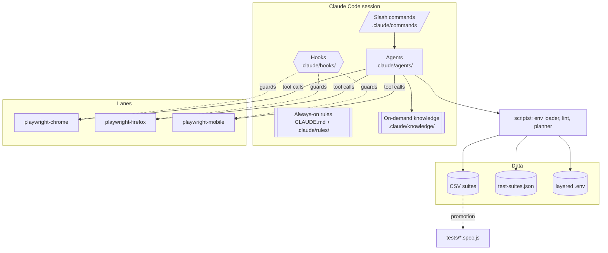

# Architecture

This document explains **what each part is, how the parts talk to each other, and why it is built this
way.** The "why" matters most: whoever adapts the template will be tempted to undo decisions whose
reasons are not obvious.

## 1. Components



| Component | Responsibility | Not its job |
|---|---|---|
| Slash command | The entry point: parses arguments, sets up a RUN_ID, picks the agent | Testing |
| Orchestrator agents | Planning, dispatch, merging, verdicts | Driving a browser |
| Runner and expert agents | Executing and judging cases in one lane | Deciding GO / NO-GO |
| Knowledge files | Rules, domain judgment, shared procedures | Being loaded unconditionally |
| Hooks | Hard guardrails that a prompt cannot override | Business logic |
| Skills | Methods (test design, case review, prompt review), each with a deterministic helper | Orchestration |
| Scripts | Deterministic work: config, validation, planning | Judgment |
| CSV suites + manifest | What to test, and who owns it | How to drive the browser |
| MCP lanes | An isolated browser per agent | Shared state |

## 2. Data flow of a regression run

1. `/qa-regression critical` → command → **regression-orchestrator**.
2. `npm run env:check` (pre-flight), then `npm run regression:plan -- critical --json`.
3. The planner expands the selection from the manifest and assigns suites to lanes **longest-first**. Each lane gets one MCP server from `browserPool`.
4. One **test-runner-agent** per lane is dispatched *in parallel*, each with its own `BROWSER_SERVER`.
5. Each runner reads its CSVs, resolves `{{placeholders}}`, executes the steps through `mcp__<lane>__browser_*` tools, judges the case and writes `results/<RUN_ID>/<SUITE>.json` after every suite.
6. The orchestrator checks that all files exist, retries an infrastructure-blocked suite once on the fallback lane, and writes `run.json` and `REPORT.md`.
7. **qa-lead-orchestrator** classifies the findings (known defect, blocker, ambiguity) and signs off.

## 3. Design decisions

### Tests as data, not code
A case is a CSV row because the people who know what to test (QA, BA, PO) should be able to write it
without code. Agents can read it, linters can validate it, and the same row can be promoted to code
later. The format is strict (tags, placeholders, rule ids) so it stays machine-checkable.

### An oracle, not only assertions
Assertions check what the case author thought of. The **oracle** (`BL-*` rules) checks everything the
agent observes. That is how agents find bugs outside the scripted path ("always-on detection").
Severity comes from the rule, so verdicts stay consistent across agents.

### Agent prompts: four layers
Every agent is written as **business logic → domain knowledge → skill set → design decisions**. The
layers change at different speeds: rules rarely, domain knowledge per product, technique per role,
constraints per infrastructure. Keeping them separate means you replace one layer when you adapt the
template, not the whole prompt.

### Three loading tiers for context
| Tier | Files | Cost |
|---|---|---|
| Always loaded | `CLAUDE.md`, `.claude/rules/*.md` | Paid on **every** turn and every sub-agent, so keep it tiny |
| Loaded whole when invoked | an agent file, a command file | Paid per dispatch, so keep each one focused |
| On demand | `.claude/knowledge/**` | Only when a step reads it |

Facts are stated **once** and cited elsewhere. Restated facts drift. Counts are never written into
prose; scripts print them.

### Orchestrators do not browse
Orchestrators keep a small context, so they can merge many results and reason about them. Browsing
fills the context with snapshots. Only runners and experts touch a browser.

### Lanes: one MCP server per parallel agent
Two agents on one browser corrupt each other's state (cookies, cart, focus). Each lane is a separate
Playwright MCP server with `isolated: true` (an in-memory profile). Parallelism = number of lanes.
Each lane records a HAR and screenshots into `results/lanes/<lane>/`.

### LPT scheduling, not batches
Fixed batches ("run 3, wait, run 3") cost the slowest suite of every batch. Assigning the longest
remaining suite to the least-loaded lane is near-optimal for a few lanes and tolerates wrong estimates.
`scripts/lib/scheduler.mjs` is short on purpose: measure before you optimise.

### Real-user rule as a hook, not a prompt
A prompt is a request; a hook is a guarantee. If agents may run JavaScript, they eventually "fix" a
blocked step by forcing the page, and a broken product passes. The hook allows read-only measurement
and blocks everything else.

### Evidence-first verdicts
FAIL needs a screenshot and expected vs actual. Otherwise it is AMBIGUOUS. This keeps reports
trustworthy enough that humans act on them.

## 4. Keeping the system healthy

The prompts are code an LLM executes. Two loops keep them, and the cases, from rotting:

- **Cases:** `npm run review:tests` (script) + `/qa-review-tests` (judgement) against `cases-that-catch-bugs.md`.
- **Prompts:** `npm run prompt:facts` (script) + `/prompt-review` (judgement) against `authoring-standard.md`.

The pattern is the same in both: **facts by script first, judgement second, evidence for every finding.**

## 5. Promotion: from CSV case to Playwright spec

```
Agent  ──(passes consistently, steps are stable)──▶  Candidate  ──(spec written)──▶  Automated
```

1. A case passes reliably in agent runs. Mark it `Candidate`.
2. Write a spec in `tests/` that uses `data-test` locators. Put the case id and the BL ids in the test title.
3. Set `Automation_Status=Automated` and `References=tests/<file>.spec.js`.
4. Keep the CSV row. Agents can still run it in exploratory or cross-browser runs, while CI relies on the spec.

Agents are good at changing, ambiguous and exploratory work. Specs are good at fast, cheap,
deterministic regression. Promotion moves each case to where it is cheapest to keep it.

## 6. Extending

| You want | Add |
|---|---|
| Another browser or a device lane | `config/mcp-playwright-<x>.config.json` + an `.mcp.json` entry + a `browserPool` slot |
| A new domain | `regression/suites/<domain>/`, rules in the oracle, `domain` in the manifest `_meta` |
| An API specialist | an agent file with the four layers, and an API MCP server (for example Postman) or `[API]` checks via `curl` |
| A new guardrail | a hook script + a matcher in `.claude/settings.json` + a unit test in `scripts/unit/` |
| Tracker integration, secrets, plugins | Agentic QA Enterprise (proprietary; [contact](https://www.linkedin.com/in/olga-manuylova/)) |

---
*Agentic QA Framework (lean edition) · © 2026 Olga Manuilova · MIT License · [source](https://github.com/OlgaManuilova-coder/agentic-qa-lean)*
